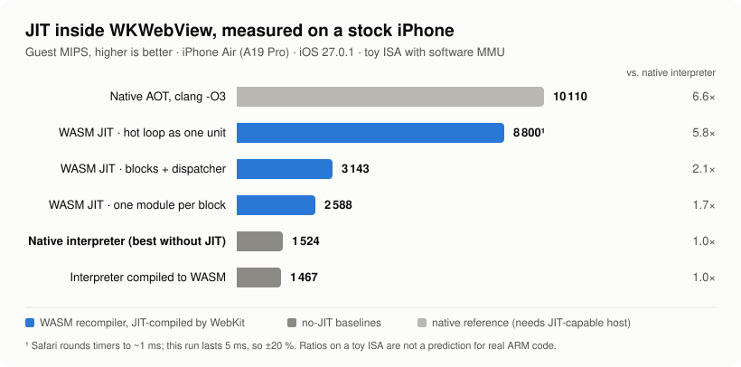
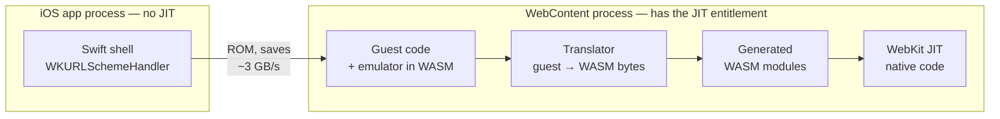

<div align="center">

# ⚡ wkwebview-jit-bench

**Can a stock iPhone run JIT-compiled code from an App Store-style app?**<br>
Yes — inside `WKWebView`. Here is how fast, measured.

[](#reproduce)
[](#how-it-works)
[](#what-else-works-inside-wkwebview)
[](#reproduce)
[](LICENSE)

<picture>
  <source media="(prefers-color-scheme: dark)" srcset="assets/benchmark-dark.svg">
  
</picture>

</div>

## The idea in 30 seconds

Apps on stock iOS can't mark memory executable, so emulators that ship through the App Store fall back to **interpreters**. But `WKWebView` runs the page in a separate WebContent process, and *that* process holds the JIT entitlement. So:

1. put the emulator in the web view (compiled to WebAssembly),
2. translate guest code to **new WASM modules at runtime**,
3. let WebKit's JIT turn them into native code.

This repo measures what that is worth, on a real phone, with a normal development certificate — no jailbreak, no debugger, no private API.

| | |
|---|---|
| 🚀 **2.1 – 2.4×** | faster than the best native interpreter, with realistic 8-instruction blocks and a dispatcher |
| 🔥 **up to ~5.8×** | when a hot loop is translated as one unit (≈ 87 % of native AOT) |
| 🧵 **threads, WebGPU, 1.9 GB RAM** | all available inside the web view |
| ⏱ **~20 µs** | to compile a new block — dynamic recompilation is affordable |

> [!IMPORTANT]
> The guest ISA is a **toy** (10 operations). The *ratios* are what's interesting; they are not a prediction for any particular emulator. See [Caveats](#caveats).

## How it works



The translator is a small hand-written WASM binary emitter ([`Web/bench.js`](Web/bench.js)) — no toolchain at runtime. Generated blocks register themselves in one shared `WebAssembly.Table` through element segments, so they can call each other with `call_indirect` without going back through JavaScript.

## Results

All numbers: **iPhone Air (A19 Pro), iOS 27.0.1**, release build. Every variant produces the same checksum as a reference implementation, so they compare equal work.

| Variant | Guest MIPS | vs. native interpreter |
|---|---:|---:|
| Native AOT, clang -O3 *(reference)* | 10 110 | 6.6× |
| WASM JIT — hot loop as one unit | ~8 800 ¹ | ~5.8× |
| WASM JIT — 8-instruction blocks + dispatcher | 3 143 – 3 667 | **2.1 – 2.4×** |
| WASM JIT — one module per block (incremental JIT layout) | 2 588 – 2 933 | 1.7 – 1.9× |
| **Native interpreter** (C, computed goto) — *the best you can do without JIT* | **1 524** | 1.0× |
| Interpreter compiled to WASM | 1 467 | 1.0× |

¹ Safari coarsens `performance.now()` to ~1 ms and this run takes 5 ms — treat as ±20 %.

Ranges are *direct addressing … software page table*. The software MMU costs surprisingly little here.

## What else works inside `WKWebView`

| Capability | Result |
|---|---|
| ✅ JIT-compiled WASM | hot code reaches ~87 % of native AOT in the best case |
| ✅ WebGPU | adapter, device and a compute shader with verified output |
| ✅ Threads | via a **shared `WebAssembly.Memory`** passed to Workers (atomics verified). With a custom URL scheme the global `SharedArrayBuffer` constructor is hidden even though `crossOriginIsolated === true`; over `http://127.0.0.1` it's visible |
| ✅ Host ↔ page calls | custom `WKURLSchemeHandler`: ~70–110 µs per sync XHR / fetch, ~3 GB/s bulk. A loopback HTTP server is ~6× slower — use the scheme handler |
| ✅ Compile cost | ~20 µs per 276-byte block (sync), ~4 µs async; instantiate 2–3 µs |
| ✅ Memory | ~1.9 GB of touched WASM memory survived; the WebContent process was killed at 2 048 MB |
| ✅ WASM tail calls | `WebAssembly.validate` accepts `return_call` |

Raw logs are in [`results/`](results/).

## What is being measured

A toy 32-bit ISA — 10 operations, 16 registers, loads/stores through a 4 KB page table (software MMU, as in any emulator without `mmap`). The guest program is a 22-instruction loop with loads, a store, a multiply and rotates.

<details>
<summary><b>Variants in detail</b></summary>

- `wasm_interp` — switch interpreter written in WAT ([`tools/build-interp.mjs`](tools/build-interp.mjs)).
- `loop_*` — the whole hot loop in one WASM function; guest registers live in WASM locals.
- `chain_*` — three blocks (8/8/6 instructions); registers are loaded/stored at block boundaries; a dispatcher loop calls blocks with `call_indirect`.
- `xmod_*` — as `chain`, but the dispatcher and every block are separate modules sharing one imported `WebAssembly.Table`. This is the layout an incremental JIT actually needs.
- `*_direct` / `*_paged` — address masking vs. page-table lookup.
- Native ([`App/Native.c`](App/Native.c)) — the same ISA as a computed-goto interpreter and as plain C.
- A pure-JS translation of the loop is included as a sanity baseline.

</details>

## Reproduce

Needs Xcode, [`xcodegen`](https://github.com/yonaskolb/XcodeGen) (`brew install xcodegen`), Node, and an iPhone with Developer Mode on.

```sh
npm install                      # wabt — only needed to rebuild Web/interp.wasm
node tools/test-node.mjs         # correctness check under V8; every variant must print "ok": true

xcodegen generate
xcodebuild -project JitSpike.xcodeproj -scheme JitSpike -configuration Release \
  -destination 'id=<DEVICE_UDID>' -allowProvisioningUpdates \
  DEVELOPMENT_TEAM=<TEAM_ID> PRODUCT_BUNDLE_IDENTIFIER=<your.bundle.id> \
  -derivedDataPath build build
xcrun devicectl device install app --device <DEVICE_UDID> \
  build/Build/Products/Release-iphoneos/JitSpike.app

# Unlock the phone and keep the app in the foreground — a backgrounded WebView is throttled.
xcrun devicectl device process launch --device <DEVICE_UDID> --console --terminate-existing \
  <your.bundle.id> -- -origin scheme -native 1
```

| Launch argument | Effect |
|---|---|
| `-origin scheme` | page served by a custom `spike://` scheme handler (default) |
| `-origin http` | page served by a `127.0.0.1` server with COOP/COEP headers |
| `-native 1` | also run the native C baseline first |
| `-phase mem` | memory-ceiling test — the web view is *expected* to be killed |

Output lines start with `SPIKE|`; `python3 tools/show-results.py <log>` prints them readably. The chart is regenerated from the logs with `python3 tools/make-chart.py`.

## Caveats

- 🧸 **The ISA is a toy.** No condition flags, conditional execution, Thumb or FPU. A real ARM translator does more work per guest instruction — and so does a real interpreter. Re-measure on real guest code before drawing conclusions.
- 📱 One device, one OS build, one set of runs. Timers are coarse.
- 🧵 The guest is single-threaded; the thread test only proves the primitives work.
- 🍎 This says **nothing about App Store review**. Guidelines 2.5.2 and 4.7 don't mention this technique and I found no shipped app that uses it. Unverified.
- ⚠️ JIT in `WKWebView` is WebKit behaviour, not a documented API guarantee. It could change.

## Why this exists

The goal is a Nintendo 3DS-class emulator that runs at useful speed on an iPhone without the JIT entitlement. The plan: fork [Panda3DS](https://github.com/wheremyfoodat/Panda3DS) (GPL-3.0), reuse the ARM front end and IR of [Dynarmic](https://github.com/azahar-emu/dynarmic) (0BSD), and write the one missing piece — an **IR → WASM backend**. This repository is the feasibility check for that plan.

**Follow-up:** the plan was carried out in [panda3ds-wasm](https://github.com/gagarinyury/panda3ds-wasm) (forks: [Panda3DS `wasm`](https://github.com/gagarinyury/Panda3DS/tree/wasm), [dynarmic `wasm32`](https://github.com/gagarinyury/dynarmic/tree/wasm32)). On an iPhone Air (iOS 27.0.1) the real Panda3DS core runs homebrew (53 of 58 devkitPro examples at the last full device run) and a commercial game boots and plays at 25–40 fps in 3D scenes (menus ~60 fps), with guest ARM recompiled to WASM at run time inside `WKWebView` and no JIT entitlement. Open: audio, exact frame pacing, save states.

---

<sub>Not affiliated with Apple or Nintendo. No game data, firmware or keys are in this repository. MIT licensed.</sub>
